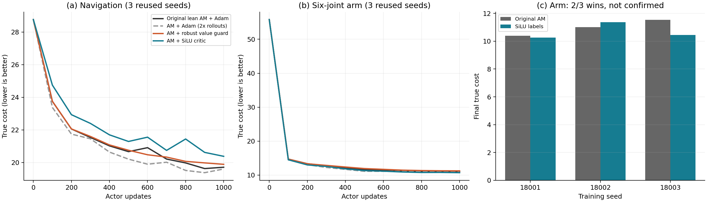

# PAGR — Propagation-Aware Gradient Robustification

终点梯度可靠性、信用分配与控制性能的研究记录。

**状态：探索性研究，不是已经验证有效的新算法。** PAGR 是暂定的、与具体框架无关的研究方向名称；当前使用 lean Adjoint Matching（AM）作为可复现试验平台。仓库保留负结果、开发阶段的选择过程和数值审计警告。

历史发布验证（2026-10-27）：本地 42/42 次固定输入重放的最终指标与 actor 参数精确一致，旧 notebook 已实际执行。GitHub hosted CI 的首个作业未能启动，**尚无云端测试通过结论**；参见 [运行记录](https://github.com/ruio248/pagr/actions/runs/40471107459) 与 [本地验证数据](provenance/publication_validation.json)。新三任务实验的本地审计与历史发布审计分别记录；不得混作同一批证据。

> Under a fixed true control objective, terminal-value estimation and terminal-gradient reliability are different questions. This repository studies how terminal-gradient errors propagate through adjoints into actor learning signals. It does **not** establish a generally superior robust-control algorithm or a new HJBI equation.

## 研究问题

在固定真实控制目标下，即使终点代价的数值估计较准确，其梯度误差仍可能通过 adjoint 传播，污染中间时刻的学习信号，降低有限训练预算下的控制性能。我们希望刻画并抑制其中真正有害的部分，同时保留有效的控制信号。

区分三件事：终点数值误差、传播后的标签/actor 更新误差、最终真实控制代价。梯度 disagreement 不是已校准的梯度误差；局部 matching loss 的下降也不是一般意义的真实控制代价下降。

新的主 Notebook 2 在**二维独立、十六维独立、十六维非线性耦合**三个任务上分别真实预训练行为 Flow，并以相同有限标量奖励数据预算比较 learned/oracle lean AM；没有 TD 自举、人为梯度污染或新误差抑制算法。这是单步 bandit 的 Flow policy extraction 平台，不是 OGBench 或 TRQAM 复现。此前的二维四模式 Flow notebook 和更早的导航 SOC notebook 都保留为历史实验。

旧 toy 数据来自自定义动力学上的自然离线轨迹和带执行噪声的终点观测。旧二维避障是四维位置–速度状态；另一旧任务是六关节平面臂的随机位姿生成，不是实物机器人实验。它们已明确归为历史导航/控制 SOC 实验，不能当作 pretrained Flow 的结果。

## 新主 Notebook 2：维度 × 耦合的探索结果

固定新 seed 38001–38003，每任务/seed 重新训练1个Base和5个标量奖励模型，Learned/Oracle各进行300步AM微调；固定第300步，以4096条共同噪声评价。真实目标是 `J=PathKL-1.5×E[R]`，越低越好。下表每个单元是三个训练 seed 的均值±seed SD；`G=(J_Learned-J_Oracle)/d` 正值表示 Oracle 在相同真实目标下更好。

| 任务 | Frozen J/d | Learned J/d | Oracle J/d | G | 终端梯度相对RMS误差 |
|---|---:|---:|---:|---:|---:|
| independent_d2 | 1.80694±0.05941 | 0.81932±0.01480 | 0.81707±0.01673 | 0.00224±0.00194 | 0.1132 |
| independent_d16 | 1.88185±0.05087 | 0.89733±0.03056 | 0.84998±0.01546 | 0.04735±0.03203 | 0.4047 |
| coupled_d16 | 1.95956±0.02122 | 1.00072±0.01534 | 0.97265±0.01194 | 0.02807±0.00578 | 0.3063 |

三个任务的 Oracle 都优于 Frozen，九个任务–seed 对中 Oracle 的真实 J 均优于 Learned。维度从2增至16时，终端梯度误差与每维 Oracle 收益空间都变大；但加入非线性耦合后，Base Jacobian 非对角占比上升，梯度误差和 G **没有继续增大**。这支持研究高维有限标量数据下的梯度可靠性，却不证明耦合必然放大损害，更不能独立归因于 adjoint：critic 拟合难度、输入分布、Base质量与 actor 状态分布也同时变化。三个 seed 是探索性证据，不是普适维度规律或新算法胜出。完整每 seed 的 J、奖励、KL、共同路径诊断、模型和数据见[已执行的新 notebook](notebooks/02_flow_am_dimension_coupling.ipynb)、[正式报告](runs/02-flow-am-dim-formal-8q5obfng/report.md)、[方法](docs/methods.md#新主-notebook-2终端梯度维度--生成结构耦合)和[审计](runs/02-flow-am-dim-formal-8q5obfng/validation.json)。

## 历史二维四模式 Flow AM 结果

正式 seeds 28001–28003，真实 FM 预训练后各微调300步，固定最终 checkpoint，4096个评估动作。下表为三个独立训练 seed 的均值；真实奖励与带路径 KL 的目标分开报告。

| 方法 | SDE 真实奖励 ↑ | 真实离散 J ↓ | finite-chain path KL（MC均值） |
|---|---:|---:|---:|
| Frozen pretrained Flow | 0.783288 | -1.174933 | 0 |
| AM-learned | 1.174199 | -1.466112 | 0.295187 |
| AM-oracle（诊断） | 1.186407 | -1.465560 | 0.314051 |
| AM-learned-2x（双倍轨迹） | 1.199065 | -1.474315 | 0.324283 |

Oracle 比 learned 的真实奖励提高 **0.012208（3/3 seed）**，但真实 J 差值为 **+0.000552**，95%配对t区间 `[-0.011603, 0.012707]`，没有确认含能量目标的稳定收益。最终共同 checkpoint 的值 RMSE/真实奖励标准差平均14.28%，梯度相对RMS误差30.43%；不能称奖励模型数值“近乎完美”。K64重训首 seed 的reward排名还发生变化，需保留离散化/有限预算限制。

已完成9次主微调、2次预定K64重训、57项运行时核验，以及**38组保存 checkpoint 的逐样本精确评估重放、101项产物验证**。见 [历史二维 Flow notebook](notebooks/archive/flow_am_four_mode/02_flow_am_terminal_gradient.ipynb)、[完整正式运行产物（含 checkpoint）](runs/02-flow-am-formal-drdkjy4g)、[结果细节](docs/results.md#预训练-flow-am平台)、[验证记录](provenance/flow_am_validation.json)、[开发修正历史](provenance/flow_am_development.json)。这是初步机制诊断，不是新算法获胜或普适 motivation 证明。

该历史任务还追加过 Oracle AM 收益空间诊断：同一组三个开发 seed 的 learned/oracle × B64/B128 完整2×2、同轨迹预算比较、768对共同 checkpoint 的重复梯度与虚拟 Adam 步、三 seed K64 重训。Oracle 提高奖励但控制能量增加，真实 J 未稳定改善；不能把这写成确认性成功。见 [历史诊断报告](runs/02-flow-am-formal-8u0sh2xk/oracle-diagnostic/report.md)、[配置](configs/oracle_am_diagnostic.json)、[492项审计](runs/02-flow-am-formal-8u0sh2xk/oracle-diagnostic/validation-v2.json)和[结果解释](docs/results.md#oracle-am-收益空间诊断追加开发实验)。

## 历史导航 / Arm 结果（不属于新 Flow 平台）

固定 3 个开发 seed（18001–18003），每种方法 1000 次 actor 更新；表中是真实评估代价，越低越好。每个最终 actor 用 4096 条评估轨迹，统计单位仍是 **3 个训练 seed**，不是 12288 次独立训练。

| 方法 | Navigation 平均代价 | Arm 平均代价 | 解释 |
|---|---:|---:|---|
| 原始 lean AM + Adam | 19.467734 | 10.973526 | 主基线 |
| AM + Adam，2×训练轨迹 | 19.413852 | 10.809225 | 额外预算对照，不是新算法 |
| Nominal value guard | 19.612436 | 11.095938 | 两任务均 0/3 seed 胜出 |
| Robust value guard | 19.642161 | 11.209811 | 两任务均 0/3 seed 胜出 |
| RBF critic | 19.316217 | 13.045337 | 对任务敏感 |
| Residual critic repair | 19.364881 | 11.017859 | 没有稳定收益 |
| SiLU critic | 20.175479 | 10.688394 | Arm 平均改善 2.60%，但仅 2/3 胜出；Navigation 恶化 |

**没有新的候选方法通过所记录的开发门槛。** 所有 seed 被复用于探索，不能把局部正结果称为独立确认，更不能由此宣称 motivation 已被完整因果验证。详见 [结果与证据边界](docs/results.md)。



## 安装与快速运行

参考环境为 Python 3.13.11、PyTorch 2.9.1、NumPy 2.3.5、SciPy 1.16.3，CPU、单线程。项目不需要 CUDA、远端服务器、API key 或下载私有数据。

```bash
git clone https://github.com/ruio248/pagr.git
cd pagr
python3.13 -m venv .venv
source .venv/bin/activate
python -m pip install --upgrade pip
python -m pip install -e '.[notebook]'
python -m pagr verify
python -m unittest discover -s tests -v
python -m pagr summary
python -m pagr replay --task arm --seed 18001 --method am_adam --output runs/arm_18001_am
```

不做 notebook 时安装 `python -m pip install -e .` 即可。系统需提供 Python 3.13；不必使用 Conda。Windows 用 `.venv\Scripts\Activate.ps1` 激活。Linux CPU-only PyTorch 安装方式、完整 42-run 重放、从零生成离线数据、执行 notebook、跨平台误差说明见 [复现指南](docs/reproduction.md)。

每次训练的输出必须使用新的空目录；默认不覆盖已有结果，也不向包内的参考数据写入。命令行直接重跑冻结设置，不提供暗中更换超参数或选最优测试 checkpoint 的选项。

## 导航

| 内容 | 入口 |
|---|---|
| **Notebook 1：可解析 motivation、AM 标签误差、因果干预与反例** | [01_motivation_analytic.ipynb](notebooks/01_motivation_analytic.ipynb) · [完整 Python 脚本](notebooks/01_motivation_analytic.py) |
| **Notebook 2：终端梯度维度 × 生成结构耦合，新的三任务主实验** | [已执行 notebook](notebooks/02_flow_am_dimension_coupling.ipynb) · [完整 Python 脚本](notebooks/02_flow_am_dimension_coupling.py) · [固定配置](configs/flow_am_dimension_coupling.json) |
| 历史二维四模式 Flow Notebook 2：负结果与全部输出保留 | [字节不变的归档](notebooks/archive/flow_am_four_mode/README.md) · [原位置入口](notebooks/02_flow_am_terminal_gradient.ipynb) · [来源 SHA-256](notebooks/archive/flow_am_four_mode/manifest.json) |
| 历史导航 SOC Notebook 2：源码与执行输出字节不变 | [归档 notebook](notebooks/archive/02_navigation_am_and_candidates.ipynb) · [源码](notebooks/archive/02_navigation_am_and_candidates.py) · [SHA-256 manifest](notebooks/archive/manifest.json) |
| 完整实验参数、随机种子、预算和指标 | [docs/settings.md](docs/settings.md) |
| 公式、lean adjoint、有限位移 guard 与实现对应 | [docs/methods.md](docs/methods.md) |
| 历史总览 notebook：全结果、两条真实重放、轨迹、机制与警告 | [notebooks/reproduce.ipynb](notebooks/reproduce.ipynb) |
| 历史实验报告及可编译 TeX 源文件 | [reports/lean_am_followup.pdf](reports/lean_am_followup.pdf)、[TeX](reports/lean_am_followup.tex) |
| 全部 42 个逐 seed 结果和最终 actor | [src/pagr/assets/reference/followup](src/pagr/assets/reference/followup) |
| 离线数据、原始/替代 critic | [src/pagr/assets](src/pagr/assets) |
| 当前实现的轻量测试 | [Flow AM 数值审计](tests/test_flow_am.py) · [历史实现测试](tests/test_research.py) |
| 来源、公开包转换和 SHA256 | [provenance/export_manifest.json](provenance/export_manifest.json) |
| GitHub 设置、隐私边界、许可证状态 | [docs/repository.md](docs/repository.md) |

两份主 notebook 的关键数学和实现直接写在单元格中，不是调用 `replay()` 的薄包装。
第一份包含严格的一步有限批量 AM–SGD 存在性结果，以及此前的冻结轨迹 AM 回归实验；
新的第二份从头做三任务的 FM 预训练和标量 reward ensemble 拟合，比较 frozen、AM-learned、AM-oracle；三个新正式 seeds，以及共同 checkpoint 的误差/Adam 诊断。四模式、2x和 K/2K 数值敏感性属于归档的上一版，不自动重跑。
两者分别回答“解析动机在什么条件下成立”和“自然估计误差在真实训练的 Flow 上是否产生可恢复损失”，不把前者当作后者成功的证明。
执行命令、输出和证据边界见下方链接中的 [Notebook 部分](docs/reproduction.md#notebook)。

**历史** Run All 验证：Notebook 1 的 387 项数值核验通过；归档导航 notebook 重新生成的 12 组数据数组、30 个 critic 和 15 个最终 actor 与冻结参考逐元素一致，最终/细网格指标也一致；历史 10 项实现测试通过。原始记录 [notebook_validation.json](provenance/notebook_validation.json) 原样保留。这是同协议重建，不是新的独立 seeds。自然导航诊断没有得到“值误差可忽略”的前提，因此不把它写成解析存在性结果在自然任务上的完整因果证明。

新三任务 Flow notebook 的协议、端点近似和正式结果分别见 [方法](docs/methods.md#新主-notebook-2终端梯度维度--生成结构耦合)、[设置](docs/settings.md#新主-notebook-2维度--耦合固定协议)、[结果](docs/results.md#新主-notebook-2维度--耦合探索实验)。历史 audits 不被新结果覆盖。

## 公开范围与许可

这不是整个工作区的备份。只收录当前梯度可靠性研究的必要代码、数据、checkpoint、结果、报告和复现入口；不含 TRQAM、机器人部署项目、SSH/代理配置、聊天附件、个人路径、密钥、虚拟环境和多 GB 的重复 rollout 缓存。

**按作者要求暂不添加许可证，后续决定。** Public 表示可公开查看，不等于已选择 MIT/Apache 等开源许可。本项目没有发布到 PyPI；`pagr-research` 是此仓库的本地安装包名。关于 GitHub 无许可证仓库的说明见 [GitHub licensing documentation](https://docs.github.com/en/repositories/managing-your-repositorys-settings-and-features/customizing-your-repository/licensing-a-repository)。
