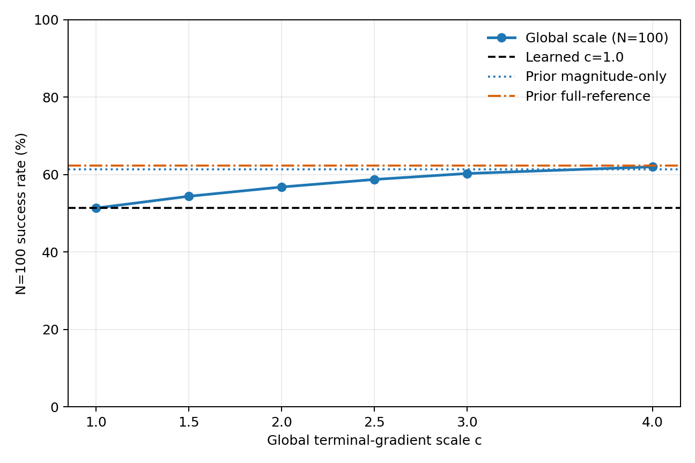
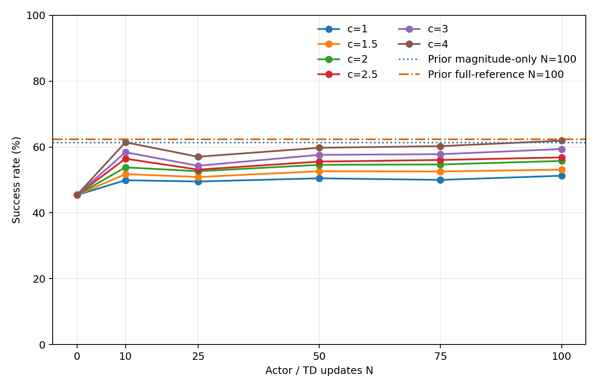

# Global Q-gradient scale control: single-seed diagnostic

## Direct answers

1. Best predeclared fixed global scale: **c=4** (ties resolve to the smaller c).
2. Its independent N=100 success rate: **62.0117%**.
3. Recovery of prior magnitude-only benefit: **107.11%**.
4. Recovery of the prior full-reference gap: **96.90%**.
5. Predeclared interpretation: **Case A**.
6. At N=100 the best c versus c=1 has terminal-gradient norm ratio 3.820, matching-parameter-gradient ratio 3.905, virtual Adam-step ratio 2.041, mean actual Adam-step ratio 1.689, and training clip fractions 0.0% vs 0.0%. Interpretation: larger virtual and realized Adam steps accompany the gain.

The result is a single-seed mechanism diagnostic, not a deployable algorithm or a general claim. The scale sweep stopped at N=100; no N=300 training or extra c values were run.

## N=100 global-scale results

| c | effective beta | Success % | Collision % | Discounted return | Δ vs c=1 (pp) | Recovery of magnitude-only |
|---:|---:|---:|---:|---:|---:|---:|
| 1.0 | 4.0 | 51.3428 | 48.6572 | -0.03226800 | +0.0000 | 0.00% |
| 1.5 | 6.0 | 54.3945 | 45.6055 | 0.01832077 | +3.0518 | 30.64% |
| 2.0 | 8.0 | 56.7871 | 43.2129 | 0.05830314 | +5.4443 | 54.66% |
| 2.5 | 10.0 | 58.7402 | 41.2598 | 0.09079593 | +7.3975 | 74.26% |
| 3.0 | 12.0 | 60.2783 | 39.7217 | 0.11697935 | +8.9355 | 89.71% |
| 4.0 | 16.0 | 62.0117 | 37.9883 | 0.14786015 | +10.6689 | 107.11% |

Prior privileged controls, not branches of this global sweep:

- Magnitude-only reference: **61.3037%**.
- Full reference: **62.3535%**.

## c=1 replay and matched design

At N=0 all six actors are identical. The c=1 branch was compared against the published Learned branch at every fixed checkpoint (N=0,10,25,50,75,100) and on the independent 4096-episode N=100 evaluation. The run proceeds to interpretation only if success, collision, and discounted return match to the frozen 1e-12 absolute tolerance.

The six branches share the exact seed-59001 initialization, TD/Actor RNG streams, minibatch draws, Flow noise, environment and evaluation banks. Each branch has its own Actor and Critic trajectory after updates. beta remains 4; only the learned terminal Q-gradient is multiplied by c.

## Update-scale and clipping diagnostics

The previous privileged update diagnostics are protocol-compatible with the c=1 replay: **True**. Rows for prior magnitude-only/full-reference are copied into `actor-update-scale-diagnostics.csv` only after the global training and c=1 checks pass.

For the best c, inspect the fixed-batch terminal-gradient, terminal-adjoint, matching-gradient, pre/post-clip norms and virtual Adam-step norm ratios versus c=1 at N=0/50/100. `training_clip_fraction` and `mean_actual_adam_step_norm` summarize actual updates through each checkpoint. Clip threshold is 5.0; terminal-gradient scale is not equivalent to an equal Actor-step scale under Adam/clipping.

## Conditional projection diagnostic

Case A passed (at least 80% of magnitude-only recovery). Per the frozen rule, the projection-only privileged experiment was **not run**; no adaptive or state-dependent calibration is pursued from this seed.

## Evidence boundary

Only seed 59001 was used. c* is the highest-success member of the six fixed global scales and is reported as a diagnostic, not selected as a production hyperparameter. The prior privileged scores are used only for post-training gap-recovery calculations; they did not select c. A Case A result means that on this seed much of the apparent magnitude-only gain is confounded with ordinary QAM guidance-strength calibration. A Case B/C result only motivates further sample-dependent analysis; it does not prove such calibration is necessary.

The global training/evaluation phase had fail-closed guards around both the current runner's MC-reference estimator and its underlying independent-MC gradient estimator. `complete.json` records zero reference-gradient calls in that phase. No HJBI ball, ensemble, covariance, SVD, new Critic, new reward/environment, adaptive c, extra c, or best-checkpoint selection was used.

## Artifacts

- `curves.csv`: common-noise 1024-episode evaluation at N=0/10/25/50/75/100.
- `final-independent.csv`: common-noise 4096-episode N=100 final evaluation.
- `scale-results.csv`: requested main table and predeclared recovery calculations.
- `actor-update-scale-diagnostics.csv`: fixed-batch gradient, clipping, virtual and actual step-scale diagnostics.
- `protocol.json`, `complete.json`: frozen settings, source hashes, and completion/replay evidence.
- `training-log.csv`: per-update losses, gradient norms, clip hits, and actual Adam-step norms.
- `success-vs-global-scale.png`, `success-curves-by-scale.png`: unsmoothed plots.
