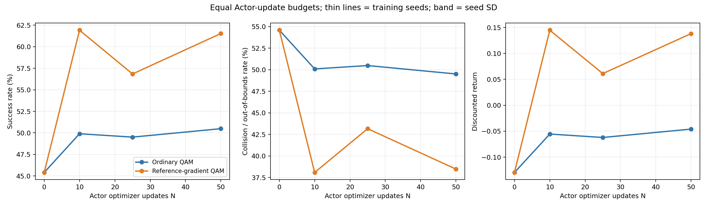
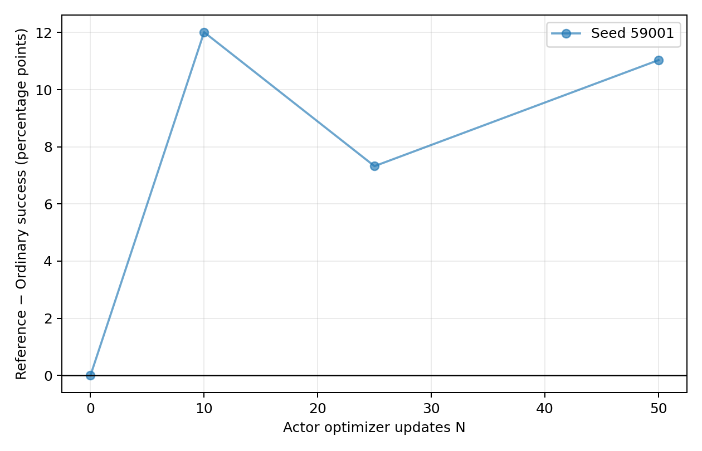

# Obstacle QAM: training-budget extension

Status: in progress / partial.
All required snapshot gradient checks passed: False.

The user approved a new gradient-focused admission protocol. Scalar Q–MC
discrepancy is reported but does not veto a gradient comparison. Historical
audit FAIL records are unchanged. This is a numerical privileged-reference
comparison, not an exact oracle or a new PAGR algorithm.

Three predeclared seeds; 300 Actor updates each; the same TD update counts,
initialization and training RNG streams within each pair. Each reference
table is rebuilt for the current Actor before its update. Extra reference
computation is not equalized with Ordinary QAM.

## Observed success gaps

| Actor updates | Mean reference − ordinary (pp) | Seed SD (pp) | Seeds |
|---:|---:|---:|---:|
| 0 | 0.000 | — | 1 |
| 10 | 12.012 | — | 1 |
| 25 | 7.324 | — | 1 |
| 50 | 11.035 | — | 1 |

## Independent final evaluation

Final checkpoints have not all been evaluated.

Snapshot validation samples eight frozen geometry cases and eight actual
training endpoints at N=0/50/150/300 per branch, with two independent
8192-rollout MC streams per point and a higher-resolution reference.
It is sampled validation, not proof of accuracy everywhere or at every update.

Fixed success thresholds are 60%, 70%, 80%; first observed crossings are
checkpoint-grid measurements, not interpolated exact crossing times.
All curves, gaps, threshold crossings, final paired episodes and audit
tables are saved alongside this report.
