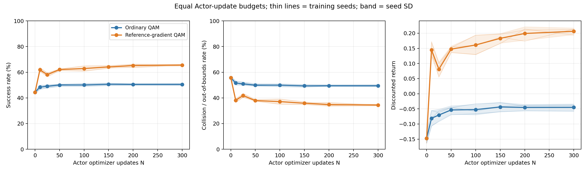
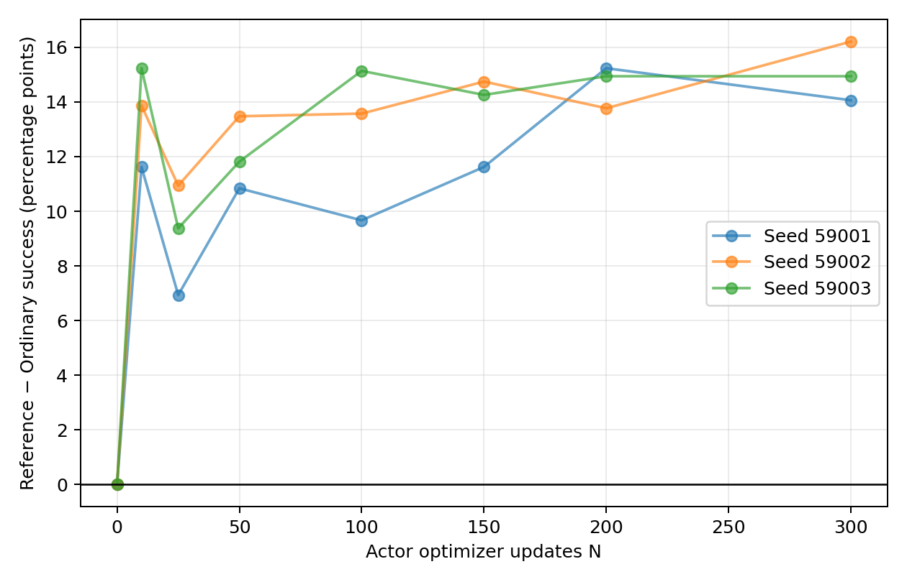

# Obstacle QAM: training-budget extension

Status: complete.
All required snapshot gradient checks passed: True.

The user approved a new gradient-focused admission protocol. Scalar Q–MC
discrepancy is reported but does not veto a gradient comparison. Historical
audit FAIL records are unchanged. This is a numerical privileged-reference
comparison, not an exact oracle or a new PAGR algorithm.

Three predeclared seeds; 300 Actor updates each; the same TD update counts,
initialization and training RNG streams within each pair.
The current-policy gradient is estimated locally from 8192 IID simulator rollouts per training endpoint; no value table or learned reference Critic is used.
Extra reference computation is not equalized with Ordinary QAM.

Success and discounted return are environment-performance metrics. They
are not the KL/energy-regularized AM extraction objective; this extension
does not establish an improvement in that full control objective.

## Observed success gaps

| Actor updates | Mean reference − ordinary (pp) | Seed SD (pp) | Seeds |
|---:|---:|---:|---:|
| 0 | 0.000 | 0.000 | 3 |
| 10 | 13.574 | 1.824 | 3 |
| 25 | 9.082 | 2.018 | 3 |
| 50 | 12.044 | 1.333 | 3 |
| 100 | 12.793 | 2.817 | 3 |
| 150 | 13.542 | 1.681 | 3 |
| 200 | 14.648 | 0.775 | 3 |
| 300 | 15.072 | 1.080 | 3 |

## Independent final evaluation

| Method | Success (%) | Collision / bounds (%) | Discounted return |
|---|---:|---:|---:|
| Ordinary QAM | 51.123 ± 1.311 | 48.869 ± 1.322 | -0.035 ± 0.021 |
| Reference-gradient QAM | 65.796 ± 0.680 | 34.204 ± 0.680 | 0.210 ± 0.012 |

Values are training-seed mean ± SD, not episode-level uncertainty.

| Seed | Success gap (pp) | Return gap | Failures repaired | Successes lost |
|---:|---:|---:|---:|---:|
| 59001 | 12.769 | 0.21387 | 562 | 39 |
| 59002 | 16.699 | 0.28057 | 789 | 105 |
| 59003 | 14.551 | 0.24280 | 640 | 44 |

Mean final success gap: 14.673 percentage points.
Within-seed evaluation SE is not training-seed uncertainty. Three seeds
remain a small exploratory sample; no universal advantage is inferred.

## Compute accounting

| Method | Updates recorded | Update wall time (s) | Extra simulator continuations |
|---|---:|---:|---:|
| Ordinary QAM | 900 | 4.88 | 0 |
| Reference-gradient QAM | 900 | 1334.72 | 471859200 |

These timings include TD and Actor/reference computation, but exclude
shared pretraining, evaluation, checkpoint serialization and precision audits.
Simulator continuations start at sampled environment times, so they have
different remaining horizons; they are not full episodes from the initial state.

Snapshot validation samples eight frozen geometry cases and eight actual
training endpoints at N=0/50/150/300 per branch, with two independent
8192-rollout MC streams per point and an independent 32768-rollout reference.
It is sampled validation, not proof of accuracy everywhere or at every update.

Fixed success thresholds are 60%, 70%, 80%; first observed crossings are
checkpoint-grid measurements, not interpolated exact crossing times.
All curves, gaps, threshold crossings, final paired episodes and audit
tables are saved alongside this report.

The table-based v1 run paused at seed 59001 reference N=50 after a
gradient mismatch near the goal. Refining the table/quadrature did not
remove it. This v2 run restarts Actor updates from N=0 with a direct MC
reference, retaining the same seeds, initialization and acceptance
thresholds. Stochastic-reference comparison SE combines both independent
estimator variances. Seed 59001 was seen during numerical development;
this is exploratory evidence, not an untouched confirmatory seed set.

The saved scalar `q_mc_z_rms` diagnostic normalizes by audit MC SE only;
unlike the gradient gate it does not include the stochastic training-reference
variance. Do not interpret it as a calibrated two-estimator significance test.
No scalar-Q diagnostic determines training admission in this protocol.
